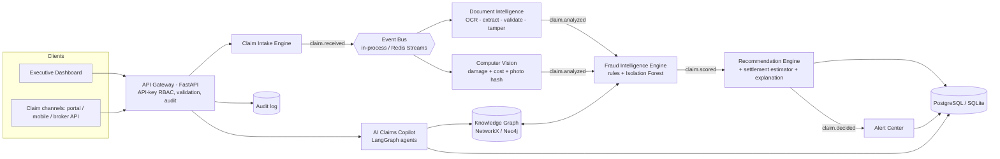

# Architecture - AI-235 Claims Intelligence & Fraud Platform

## 1. System overview

## 2. Claims intelligence pipeline (event chain)
| Event | Handler | Result |
|---|---|---|
| `claim.received` | intake checks (policy exists, required fields) | claim stored, graph node added |
| (upload) document / image | OCR, extraction, validation, ELA; YOLO/OpenCV damage + cost; dHash | stored on claim |
| `claim.analyzed` | `FraudEngine.evaluate` | score, level, indicators, ring |
| `claim.scored` | `recommender.recommend`, settlement, explanation | action, priority, status, investigator |
| `claim.decided` | alert builder + audit | alerts (deduplicated), audit trail |

Every upload re-publishes `claim.analyzed`, so scores always reflect the latest evidence. Human decisions
(`APPROVED/REJECTED/SETTLED`) are final and never overridden by re-scoring.

## 3. Explainable AI (10% of grade)
* **Rules are additive and named.** score = min(1, sum(points)/100); each indicator carries `code`, `label`, `points`, `detail`.
  The dashboard shows the decomposition as bars; the copilot narrates it.
* **Anomaly model is explained too.** Isolation Forest (trained lazily after 60 claims, retrained every 40) contributes 15% and reports the
  features with the largest z-scores (`ANOMALY_*` indicators, 0 points).
* **Document findings** are cited verbatim (e.g. "Claimed 9,000 is 3.1x the repair estimate total 2,900").
* **Settlement estimate** is a transparent waterfall: claimed -> limited by documents/AI estimate -> deductible -> coverage cap.
* **Decision card** (`claims.explanation`) stores summary, factors, recommendation reasons, settlement, ring, duplicates, model versions.

## 4. Fraud knowledge graph
Nodes: Customer, Policy, Claim, Provider (hospital/workshop), Doctor, BankAccount, Phone, Address, Identity, Vehicle, Investigator.
* **Strong links** (bank, phone, address, identity, vehicle) join customers who share them.
* **Suspect providers** (>=6 claims and >=40% high-risk) also join their customers.
* `rings()` returns connected components >= 3 customers with size, exposure, shared entities, top providers and a ring score.
* `rescore_ring_members()` is the periodic batch job that flags early ring members retroactively.
* Neo4j: set `NEO4J_URI`; claims are MERGE'd as they arrive. Use Cypher / GDS (Louvain, WCC, node similarity) for graphs too big for memory.

## 5. Computer vision
`vision.assess()` -> `{damage_type, severity 0..1, severity_label, estimated_cost{low,expected,high}, detections, method}`.
* **Baseline (default):** HSV flame/char/mud ratios, Canny edge density, contour area -> severity -> cost = base(asset) x severity^1.2.
* **YOLO11 (when `YOLO_WEIGHTS` set):** detections (dent, scratch, crack, broken_glass, lamp_broken, bumper_damage, fire, flood...) weighted by
  class and area. **Training plan:** CarDD / Roboflow car-damage datasets -> `yolo detect train model=yolo11s.pt data=damage.yaml epochs=80 imgsz=640`
  -> evaluate mAP50 -> export `best.pt`. For cost, train a small regressor on (class areas, vehicle make, panel) -> repair invoice amounts.
* **Reused-photo detection:** 64-bit difference hash, Hamming distance <= 5 across all claims (catches recompressed/resized duplicates).

## 6. Scaling to 25 M claims / real-time
| Concern | Design |
|---|---|
| Throughput | Stateless API behind a load balancer; pipeline handlers become consumers of Redis Streams / Kafka topics (`claims.events`) in consumer groups. OCR and CV workers scale independently on GPU nodes. |
| Database | PostgreSQL with partitioning by `filed_date`, indexes already on customer/policy/provider/status; read replicas for the dashboard; materialised views for KPIs. |
| Graph | Neo4j cluster; incremental `MERGE` per claim; nightly GDS community detection feeds `rescore_ring_members`. |
| Files | 300 TB images/documents -> object storage (S3/MinIO), DB keeps URIs + hashes. |
| Fraud scoring | Rules are O(1)-ish indexed lookups (< 50 ms); Isolation Forest scoring is microseconds; cache per-type medians in Redis. |
| Similar-claim search | Replace TF-IDF with sentence embeddings + FAISS/pgvector (`Platform.similar_claims` is the single swap point). |
| High availability | Multiple API replicas, Postgres HA (Patroni), Redis Sentinel, Neo4j causal cluster; idempotent handlers make retries safe. |

## 7. Security & compliance
API-key RBAC (viewer/investigator/admin) - swap for OAuth2/OIDC in production; all state changes and copilot queries are written to `audit_log`
(who, what, when, detail); uploads sanitised and stored per claim; PII fields isolated to claim rows (add column encryption / tokenisation for regulated
deployments); explanations support regulator "right to explanation" requests; human-in-the-loop on every non-auto decision.

## 8. Extension points (bonus challenges)
* **AI repair-cost estimator** - already produces low/expected/high bands; add a regressor over detections.
* **Deepfake document detection** - extend `tamper_analysis` with a CNN (e.g. CAT-Net / TruFor) behind the same `(score, reasons)` interface.
* **Cross-insurance network** - hash identifiers (HMAC) and exchange graph edges between insurers; `FraudGraph.add_claim` already takes any node kinds.
* **Voice verification** - add `/api/claims/{id}/voice` -> speech-to-text -> reuse document extraction + consistency checks.
* **Settlement negotiation assistant** - new copilot agent using `estimate_settlement` bands.
